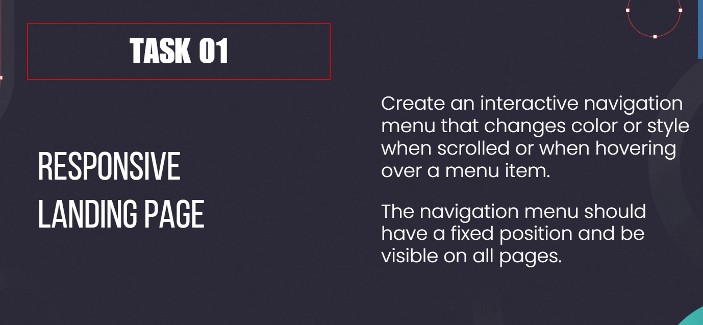

# 📷 PhotoGallery

A stunning, fully client-side photo gallery web app that lets you browse a curated collection of beautiful photographs with smooth animations and a rich user experience.



---

## ✨ Features

- **Category Filtering** — Browse photos by All, Nature, City, Abstract, or People
- **Live Search** — Instantly find photos by keyword as you type
- **Like System** — Heart your favourite photos; liked count is tracked in the stats bar
- **Lightbox Viewer** — Click any photo to open a full-screen overlay with title, description, tag, and prev/next navigation
- **Responsive Grid Layout** — Masonry-style grid that adapts from mobile to desktop
- **Stats Bar** — At-a-glance counters for total photos, liked photos, and categories
- **Keyboard Navigation** — Use `←` / `→` arrow keys inside the lightbox
- **Smooth Animations** — CSS transitions and fade-in effects throughout

---

## 🛠️ Tech Stack

| Technology | Purpose |
|---|---|
| HTML5 | Page structure & semantics |
| CSS3 | Styling, grid layout, animations |
| Vanilla JavaScript (ES6+) | Gallery logic, filtering, lightbox |
| Google Fonts (Outfit) | Typography |

> No frameworks. No build step. Just open `index.html` in your browser.

---

## 🚀 Getting Started

```bash
# 1. Clone or download the project
git clone <your-repo-url>

# 2. Open in your browser — no server needed
start index.html      # Windows
open index.html       # macOS
```

---

## 📁 Project Structure

```
PhotoGallery/
├── index.html      ← App entry point & layout
├── style.css       ← All styles (dark theme, grid, lightbox)
├── app.js          ← Photo data, filtering, search & lightbox logic
└── image.png       ← Preview / placeholder image
```

---

## 🎮 How to Use

1. **Browse** — The gallery loads all photos on arrival.
2. **Filter** — Click a category button (Nature, City, etc.) in the header nav.
3. **Search** — Type in the search bar to filter photos by name.
4. **Open** — Click any image to open it in the lightbox.
5. **Navigate** — Use the `‹` / `›` arrows (or keyboard arrow keys) to move between photos.
6. **Like** — Click the ❤️ icon on any card or inside the lightbox to like a photo.
7. **Close** — Press `Esc` or the `✕` button to close the lightbox.

---

## 🌐 Live Demo

> 🔗 **[Add your deployment link here]**

---

## 📄 License

This project is open source and available under the [MIT License](https://opensource.org/licenses/MIT).

---

<p align="center">Made with ❤️ · PhotoGallery © 2026</p>
